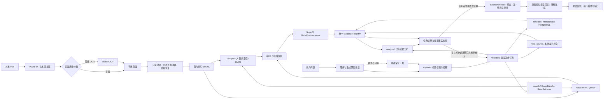

# RAG 实现说明

本文描述仓库当前实际运行的 LlamaIndex Plan-and-Execute RAG 链路，包括 PDF 抽取、清洗与分片、关键词和向量索引、研究计划、任务执行、双路召回、融合与重排、证据管理、答案综合、流式输出和离线引用评测。生产回答交付前只做 S1 引用检查（移除无法核实的引用标记和冲突页码），不做日期校验或引用修复。

实现核对日期为 2026-10-23。本文说明当前代码行为；第 13 节的规模数字是注明日期的历史构建快照，不代表实时服务状态。本轮编排重构没有重建数据或索引，也没有产生新的检索质量评测结论。产品目标仍以 [需求基线](REQUIREMENTS.md) 为准，本文中的实现边界不降低原有验收要求。

## 1. 总体架构

所有问答只经过一个 `HistoryResearchWorkflow`：理解与规划 → 按依赖执行任务 → 检查证据缺口 → 必要时增补计划 → 综合与交付。`service.py` 和 `streaming.py` 分别适配普通响应与 SSE，共用这个执行入口；没有独立的旧编排、结构化问答主流程或流式生成循环。

简单问题通常编译成一个取证任务，例如检索某个观点、查询一位人物整年活动或读取一篇全文。复杂比较与研究问题可以形成有向无环任务图（DAG）：先分别取证，再由依赖这些证据的 `analyze` 任务比较、归纳，最后统一综合。复杂度体现在同一计划的任务和依赖中，不通过另设“简单/复杂”执行器实现。

允许的工具只有 `search`、`timeline`、`intersection`、`read_source` 和 `analyze`。前三类分别使用已有混合检索、人物时间线和共同动作候选查询；`read_source` 按本地篇目结构读取原文；`analyze` 只处理依赖任务已经取得的证据，不检索外网，也不自行重规划。只有明确人物、完整年份或年份区间的时间线/交集适合结构化工具；月份、地点、否定或指定来源等细约束交给混合检索。全文和结构化工具无需访问向量库，但仍受统一 Workflow 管理。

模型不可用或计划校验失败时，系统在同一 Workflow 内编译保守计划：明确全文请求使用 `read_source`；能由本地人物别名和严格语法确认的整年时间线/交集使用相应结构化工具；其他问题保留原问题使用 `search`。规划失败不会启动另一套问答流程。

“某年之前/以前/之后/以后”属于已经明确的开放边界，不触发“请明确人物和年份”。其中
“1949 年之前”按研究起点至 1948 年解释；带“及”的“1949 年及以前”才包含 1949 年。
双人物的开放边界交集由查询理解模型规范化边界，并使用分阶段混合检索。



### 1.1 LlamaIndex 框架职责

`llama-index-core` 参与完整问答生命周期：

- 查询计划和证据评估的结构化输出由 `PydanticOutputParser` 解析与校验；
- 主查询和扩展查询封装为 `QueryBundle`；
- 关键词与向量融合后端实现为 `BaseRetriever`；
- 每个领域 `SearchHit` 转换为 `TextNode + NodeWithScore`，完整保留文献、页码、章节、年份、人物和原始排序元数据；
- 节点去重、合法性检查和数量限制由 `BaseNodePostprocessor` 执行；
- `HistoryResearchWorkflow` 以类型化 Event 和 Context 管理规划、任务依赖、并发执行、证据检查、计划增补、综合及停止；
- `HistoryResponseSynthesizer` 实现 `BaseSynthesizer`，接收统一证据 Node，管理分组摘要和最终综合，直接返回模型回答；
- 查询规划、证据充分性判断、最终回答和流式回答统一通过自定义 `DeepSeekLlamaIndexLLM`；该适配器实现 LlamaIndex `LLM` 接口，接入共享 `CallbackManager`，同时保留连接池、并发准入、请求总预算、供应商 `thinking` 参数和 SSE 故障降级；
- 最终证据回答提示词由 `ChatPromptTemplate` 构造。

框架与领域层之间通过适配器隔离。关键词 BM25、FastEmbed/Qdrant、RRF、年代覆盖、人物
硬过滤和证据门槛没有替换成通用默认实现，因为这些规则是当前评测表现和史料可核验性的
关键；日期与未引用事实的引用一致性检查只保留在离线评测中，生产交付仅执行第 12.1 节的
S1 引用检查。所有问答响应均公开 `rag_framework=llamaindex`，包括结构化取证、全文读取及无模型摘录。
独立的直接检索或研究 CLI/API 是底层能力接口，不构成第二套问答编排。主库、会话库、关键词索引
继续使用 PostgreSQL，向量索引继续使用独立 Qdrant 服务；本轮不改变嵌入模型、索引和备份，
不引入 SQLite 后端或兼容分支。

健康检查以 `answer_workflow=plan_and_execute` 和 `rag_execution_paths=["llamaindex"]` 标识当前问答入口。

### 1.2 框架组件取舍

统一框架生命周期不要求更换已有检索算法和存储协议：

| 候选组件 | 当前结论 | 原因 |
| --- | --- | --- |
| `QueryFusionRetriever` | 暂不接入 | 每个查询的 BM25 与向量分支并发执行，多查询依次执行后按计划融合；人物硬过滤、年代覆盖与 RRF 已由领域实现统一处理，再套一层通用融合会重复计分并改变已有评测语义。 |
| `QdrantVectorStore` | 暂不接管存储 | 索引使用稳定 chunk UUID、完整可回填 `SearchHit` 的 payload、服务 collection 的原子 alias 切换及专用过滤。当前保留领域适配器；框架存储适配迁移应单独评估。 |
| `BaseSynthesizer` | 已由 `HistoryResponseSynthesizer` 实现 | 在框架合成接口内保留分组摘要、稳定引用 ID 和模型回答直接交付；不做生产引用校验或修复。 |

这里的原则不是排斥框架组件，而是只让框架接管具有统一生命周期和可观测性收益的部分。
当前实际接入的是 `Workflow`、类型化 Event/Context、`QueryBundle`、`BaseRetriever`、证据 Node、
NodePostprocessor、BaseSynthesizer、LLM/CallbackManager、Pydantic 输出解析器和提示词模板。后端存储、领域融合、
证据约束仍通过明确的扩展接口保留。

### 1.3 篇目全文工具

明确包含书名号篇名和“全文”“完整原文”等标记的请求编译为 `read_source` 任务。系统先在
`data/processed/structure/*.json` 中精确匹配篇名，再只读取对应文档的 chunk 文件，并按
章节页码、`section_path` 和 `chunk_index` 恢复正文。若存在同名篇目，优先选择问题中明确
提到作者的选集来源；仍无法消歧时要求用户补充作者或文献名，不用零散相似片段冒充全文。

单任务全文响应使用 `retrieval_mode=full_text` 和 `generator_mode=extractive`，保留篇目起止
PDF 页码。全文工具本身不调用混合召回或答案生成模型；复杂计划可以把读取结果用于后续比较与综合。单任务原文交付不会受普通问答
的 Top-K、420 字引文和 5000-token 生成上限影响；网页只在后续对话历史里截断超长答案，
当前轮展示的全文不截断。

### 1.4 计划、预算与执行记录

`ResearchPlan` 保存原始问题、语义解释、任务 DAG 和版本；`TaskResult` 保存任务状态、证据 ID、分析结论、缺口、错误及用量。初始规划通过一次模型调用同时生成理解结果和任务，提示词通常限制最多 6 个初始任务，并随显式 Token 上限收紧，为后续取证留下空间。模型输出仍必须通过总计 8 个任务的硬上限、工具白名单、年份/来源/人物约束和无环依赖校验。

调度器同时执行最多 2 个就绪任务，优先取证后分析。工具不可用时，在剩余预算内最多重试一次；这是同一任务的重试，不增加第二个执行器。证据检查可以提出定向补检：结构化时间线无记录或不适用时可增加 `search`，复杂检索问题可按语义覆盖缺口追加检索。交集查询没有共同动作候选不等于两人无交集，也不会自动把宽泛共现替换为已确认交集。

计划最多增补 2 次、全部版本合计最多 8 个任务。增补只追加任务和调整尚未执行的分析任务依赖，不修改用户约束或已执行任务；改为等待补检的分析任务仍保留原分支证据。分析任务已执行但报告具体证据缺口时，在任务槽位和增补预算允许的情况下追加一个 `search` 与一个依赖补检结果的新 `analyze` 任务，保留原分析记录。补检结果再次经过检查，到达上限后交付已有材料和未解决方面，不无限循环。

规划、活动主体检查、证据评估、任务分析、分组摘要、最终综合和一次修复共用请求 deadline（默认 90 秒）以及最多 24 次模型调用预算；排队也计入剩余时间。调用数上限是请求内硬限额，不代表每题都会调用 24 次。没有模型时仍可交付本地证据；服务不可用与没有史料分别报告。取消请求会取消 Workflow 与后续模型调用，部分草稿不写入会话。

响应的 `research_plan` 和 `execution_summary` 提供实际任务图、各任务结果、增补次数、阶段用量、检索调用数及停止原因。`query_plan` 是理解结果，旧 `retrieval_reflection_status`、`retrieval_rounds` 等展示字段仅映射实际执行摘要，不触发旧反思循环。`retrieval_rounds` 当前等于计划版本数，不等于检索任务数；完整缺口见任务结果，旧缺口展示字段最多保留 4 项。模型用量只记录供应商实际返回的数据，不能把缺失用量理解为零消耗。

离线数据流的核心产物如下：

| 阶段 | 产物 | 默认位置 |
| --- | --- | --- |
| 文本层抽取 | 每页一条 `PageRecord` | `data/processed/pages/*.jsonl` |
| OCR | 需要 OCR 的页面记录 | `data/processed/ocr/*.jsonl` |
| 结构恢复 | PDF 目录或年份章节 | `data/processed/structure/*.json` |
| 分片 | 每个文档一份 chunk JSONL | `data/processed/chunks/*.jsonl` |
| 关键词索引 | PostgreSQL 倒排词位与 BM25 | `HISTORY_AGENT_KEYWORD_DATABASE_URL`，默认共用主库 |
| 向量索引 | 独立 Qdrant 服务 collection / alias | `HISTORY_AGENT_QDRANT_URL`；本机服务存储在 `data/qdrant-service/` |
| 嵌入模型缓存 | FastEmbed 模型文件 | `data/models/fastembed/` |

## 2. PDF 抽取和 OCR

### 2.1 文本层抽取

默认解析器是 PyMuPDF。系统逐个物理 PDF 页调用 `page.get_text("text")`，同时统计该页的图片对象数量。某一页的 PyMuPDF 抽取失败时，仅该页回退到 pypdf 的 `page.extract_text()`，并记录 `primary_parser_failed_used_pypdf` 质量标记。也可以通过命令显式选择 pypdf 作为主解析器。

页面阶段只做尽量无损的标准化：

- 把 CRLF 和 CR 统一为 LF；
- 删除 NUL 字符；
- 不在这一阶段合并段落、删除页眉或切分句子。

每个页面记录保存文档 ID、文件 SHA-256、物理 PDF 页码、原始文本、标准化文本、文本 SHA-256、字符数、中文字符数、替换字符数、图片对象数、抽取方法和版本、质量标记、运行 ID 与处理时间。

抽取结果按文件 SHA-256 和抽取器版本复用。状态为 `failed` 的旧记录不会复用；处理中间结果写入 `.partial.jsonl`，每处理 100 页刷新一次，完成后原子替换正式 JSONL。因此中断后可以从已完成页面继续。

### 2.2 页面质量分类

系统先删除空白字符后判断页面内容：

- 无文本且存在图片对象：标记为 `ocr_required`；
- 无文本且无图片对象：标记为 `empty`；
- 少于 50 个非空白字符：保留文本，但添加 `very_short_text`；
- Unicode 替换字符 `U+FFFD` 占比超过 1%：标记为 `ocr_required`；
- 没有中文字符：添加 `no_cjk_characters`，但只要没有严重替换字符，仍可作为已抽取页使用。

语料目录还可把整个文档或指定页面强制标记为需要 OCR。当前目录中同时使用 `partial_required`、`partial_if_needed` 和 `full_required` 策略。

### 2.3 OCR

OCR 使用 PaddleOCR，当前默认参数为：

| 参数 | 当前值 |
| --- | --- |
| PDF 渲染 DPI | 110 |
| 检测模型 | `PP-OCRv5_mobile_det` |
| 识别模型 | `PP-OCRv5_mobile_rec` |
| 推理引擎 | Paddle |
| MKL-DNN | 开启 |
| CPU 线程 | 2 |
| 文档方向分类 | 关闭 |
| 文档去畸变 | 关闭 |
| 文本行方向分类 | 关闭 |

OCR 也按文件 SHA-256 和 OCR 引擎版本复用。构建 chunk 时，页面文本的选择规则是：

1. 文本层记录状态为 `extracted` 且非空时，使用文本层结果；
2. 只有文本层状态为 `ocr_required`，并且对应 OCR 记录状态为 `extracted` 且非空时，才使用 OCR 结果；
3. 不把文本层和 OCR 文本拼接，也不在查询时动态 OCR。

## 3. 页面清洗和结构恢复

### 3.1 目录和扫描附页过滤

若一个页面前 12 个非空行中出现“目录”，并且至少 3 行包含五个以上连续英文句点或省略号，则整页视为目录页，不参与分片。

针对扫描年谱，另识别具有明确“目录”标题和至少三组严格年份／页码条目的页面，兼容 OCR 丢失点线与标题拆行。整页只包含固定前缀和年份标签的书签导出列表也会过滤。扫描元数据页必须同时具有 General Information 标题（含已核实的 OCR 变体）和至少三个不同书目字段；仅由 ISBN、条码及定价构成的封底同样不参与分片。普通正文中提及这些词语不会单独触发过滤。

### 3.2 重复页眉页脚和页码

系统从每页的前 2 行和后 2 行收集边缘文本。一行满足以下条件时，被视为重复页眉或页脚并从所有页面删除：

- 长度为 2 到 50 个字符；
- 不是纯数字页码行；
- 至少出现在 `max(5, round(总页数 × 4%))` 个页面的页边缘。

由 1 到 4 位数字以及可选空格、横线组成的独立页码行也会删除。这里使用的是 PDF 文本行规则，不会根据版面坐标裁切页面。

### 3.3 段落重建

清洗时先把半角空格、Tab 和全角空格压缩成一个空格，再去掉行首尾空白。普通换行会直接拼接，遇到下列情况结束当前段落：

- 空行；
- 识别到章节、年份或“目录/前言/序言/引言/后记/附录”等标题；
- 行尾是 `。！？；：…）”』】` 中的一个字符。

最终清洗文本用换行分隔重建后的段落。

### 3.4 章节路径

结构恢复有三级回退：

1. PDF 存在有效书签目录时，使用 PyMuPDF 读取目录层级和起始页；同层或更高层的下一个条目决定当前条目的结束页。纯页码书签、仅封面等前置条目、逆序页码及多个年份全部指向同页的失效书签不能作为正文结构。
2. 没有有效 PDF 目录时，识别整行“年份＋年龄／诞生”的标题，兼容年龄拆行与原书省略“年”字的格式，每个年份第一次出现的位置成为一级章节起点。明确的“后记”正文标题单独成节，末尾扫描附页不延长最后年度。
3. 两者都没有时，整个文档使用一个以文献标题命名的根章节。

对每个物理页，系统选取覆盖该页的各级最新章节，形成 `section_path`。章节路径随后参与年份提取、关键词搜索文本和向量嵌入。

## 4. 分片实现

当前分片器版本是 `page-sentence-chunker-v1`，清洗器版本是 `page-cleaner-v2`。

### 4.1 分片边界和长度

分片严格限制在单个物理 PDF 页内，不跨页，也没有重叠窗口。默认参数为：

| 参数 | 值 | 含义 |
| --- | ---: | --- |
| `target_chars` | 650 字符 | 缓冲区达到该长度后优先输出 |
| `max_chars` | 900 字符 | 单个 chunk 的硬上限 |
| 最短 chunk | 20 字符 | 更短内容丢弃 |
| 尾段合并阈值 | 80 字符 | 小尾段在不超过 900 字符时并入前一块 |
| overlap | 0 | 当前没有重叠 |

具体算法如下：

1. 按清洗后的换行取得段落。
2. 在 `。！？；` 后切成句子单元。
3. 顺序把句子加入缓冲区；若加入后会超过 900 字符，先输出旧缓冲区。
4. 缓冲区达到 650 字符后立即输出，因此常见 chunk 接近 650 到 900 字符。
5. 单个句子超过 900 字符时，直接按每 900 字符硬切。
6. 页尾剩余内容少于 80 字符，并且与前一块合并后不超过 900 字符时，合并到前一块。
7. 删除不足 20 字符的块。

650 是目标值而不是下限。页面末尾、标题和短页仍会产生短于 650 字符的有效 chunk。

### 4.2 Chunk 标识和相邻关系

`chunk_id` 根据以下内容计算两次 SHA-256，最终保留 32 个十六进制字符：

```text
document_id:file_sha256:pdf_page:page_chunk_index:cleaner_version:chunker_version:content_hash
```

其中 `content_hash` 是清洗后 chunk 文本的完整 SHA-256。Qdrant 点 ID 直接把 32 位 `chunk_id` 转成 UUID。

每个 chunk 记录同一文档中的 `previous_chunk_id` 和 `next_chunk_id`。当前在线召回不会根据这些字段扩展相邻 chunk，它们只是为后续上下文扩展保留。

### 4.3 时间和人物元数据

时间抽取支持：

- `18xx`、`19xx`、`20xx` 年，可带阿拉伯数字月、日；
- 由 `〇○零一二三四五六七八九` 组成的四位中文年份。

chunk 正文和章节路径中的年份、日期会合并为 `year_mentions` 与 `date_mentions`。研究范围默认是 1921—1978 年，系统据此给 chunk 标记：

- `in_scope`：所有用于判定的年份都在范围内；
- `out_of_scope`：全部在范围外；
- `mixed`：范围内外年份同时出现；
- `unknown`：没有识别到年份。

对 `chronology` 年谱类文献，如果章节路径恰好只有一个年份，则用章节年份判定范围，避免正文中提到其他年份导致误判；其他文献使用正文与章节合并后的全部年份。

人物识别读取 `config/person_aliases.json`。只要规范名或任一别名作为字面字符串出现在 chunk 正文中，就写入规范人物名。这里没有命名实体识别模型，也没有上下文消歧模型。

### 4.4 Chunk 字段和搜索文本

主要字段包括：

- 文档：`document_id`、标题、文件名、作者/编者、来源类型、版次、卷次、核验状态、文件 SHA-256；
- 位置：文档内 chunk 序号、页内序号、PDF 物理页、可选印刷页、章节路径；
- 内容：正文、字符数、内容哈希、清洗器和分片器版本；
- 语义元数据：年份、日期、研究范围状态、人物、抽取方法；
- 链接：前一个和后一个 chunk ID。

关键词索引使用的 `search_text` 为：

```text
chunk正文 + 文献标题 + section_path + 规范人物名 + “YYYY年”
```

向量索引使用另一份输入，见第 6 节。

## 5. 关键词索引：PostgreSQL + FTS5 兼容 BM25

### 5.1 索引结构

关键词索引仅使用 PostgreSQL，索引版本为 `postgresql-fts5-bm25-compatible-v1`。
`keyword_chunks` 保存完整元数据、原预分词文本、长度和原始行号；
`keyword_postings` 保存倒排词项及词位。`keyword_generations` 与 `keyword_active`
管理索引版本，完整数据校验通过后在同一事务中切换活动版本。
构建、搜索及评测通过统一入口选择目标，详见 [迁移与评测说明](KEYWORD_POSTGRESQL.md)。

原 FTS5 的底层 tokenizer 是 `unicode61 remove_diacritics 2`。中文切词由应用层预先完成。
PostgreSQL 后端以纯 Python 保留预分词结果的词法及短语语义，不调用 SQLite 词法器。
原 SQLite 对照后端和迁移代码已移除，冻结的迁移评测结果仍保留。

PostgreSQL 后端构建新版本并核对全部元数据和词位摘要，失败时保留原活动版本。

### 5.2 中文和非中文分词

对连续中文字符使用相邻二元字 bigram。例如：

```text
抗日战争 -> 抗日 / 日战 / 战争
```

长度为 1 或 2 的中文串保持原样。英文、数字及包含连字符或下划线的英文标识使用正则提取并转为小写。四位年份还会显式加入 `YYYY` 和 `YYYY年` 两个 token。

查询端使用相同 tokenizer，然后：

- 删除“哪些、什么、怎么、如何、主要、请问、经历、观点、交集、期间”等停用词；
- 删除以“的、了、在、和、与、及、是、有、为、于、把、被、从、对”等虚词开头或结尾的中文 token；
- 去重；
- 没有剩余可检索 token 时直接报检索错误。

查询语义保持所有 token 的精确短语 OR，原 FTS 表达式为：

```text
"毛泽" OR "泽东" OR "抗日" OR "日战" OR "战争" ...
```

因此关键词召回本身偏宽，不要求所有词同时出现；人物、年份和研究范围由元数据过滤补充约束。

### 5.3 BM25 排名和来源偏置

PostgreSQL 后端显式实现原 SQLite `bm25(chunk_fts)` 的计分规则：
`k1=1.2`、`b=0.75`，使用全索引统计，非正 IDF 取 `1e-6`。
原始值越小越靠前，同分保留原 FTS 行号顺序。系统减去以下奖励值：

| 条件 | BM25 排序奖励 |
| --- | ---: |
| 时间线问题命中 `chronology` | 4.0 |
| 观点问题命中 `selected_works` | 4.0 |
| 查询人物出现在文献 `creators` | 2.0 |

返回给上层的关键词 `score` 是调整后 `raw_score` 的相反数，并保留 6 位小数。混合融合阶段只使用关键词排名，不使用这个分数的绝对大小。

## 6. 向量索引：FastEmbed + Qdrant

### 6.1 文本嵌入模型

当前模型和索引参数为：

| 项目 | 当前值 |
| --- | --- |
| 嵌入模型 | `BAAI/bge-small-zh-v1.5` |
| 向量维度 | 512 |
| 相似度 | Cosine |
| 推理库 | FastEmbed |
| 模型线程数 | `min(8, CPU逻辑核数)`，最少 1 |
| 建库 batch size | 64，可通过 CLI 调整到 1—512 |
| 向量库 | Qdrant 独立服务；显式精确检索 |
| collection | `history_chunks` |

文档侧嵌入输入为：

```text
文献标题
章节1 > 章节2 > ...
chunk正文
```

它不使用关键词索引中的完整 `search_text`，不会额外拼接人物规范名和合成年份；但标题与章节会进入嵌入文本。查询侧调用 FastEmbed 的 `query_embed(query)`，文档侧调用 `embed(...)`。

### 6.2 Qdrant payload 和原子构建

每个向量点同时保存 chunk ID、文档元数据、页码、章节、正文、年份、人物、范围状态和抽取方法，便于在 Qdrant 内过滤并直接还原 `SearchHit`。

构建时创建新的 Qdrant collection，分批 upsert，最后执行精确计数；点数必须等于 chunk 数。成功后原子切换 `history_chunks` alias，保留旧 collection。当前代码只支持服务 HTTP 客户端；旧本地目录与迁移报告仅作为历史存档保留，运行与测试不再读取旧本地索引。

### 6.3 向量候选排序

普通查询直接按 Qdrant 的余弦相似度取候选。仅在有明确年份、意图为 `timeline`，且没有计划年份区间或显式区间表达时，才扩充候选池：

```text
candidate_limit = min(500, max(100, top_k × 20))
```

系统随后把章节路径包含目标年份的候选放到正文偶然提及该年份的候选之前，再截取向量分支自己的 `top_k`。已有计划年份区间时直接按区间过滤，不额外执行这一扩池规则。

## 7. 查询理解和过滤

启用查询规划且已配置模型时，所有问法先调用 `deepseek-v4-flash` 非思考模式，要求以紧凑 JSON 同时输出理解结果与可执行任务。理解结果包含规范问题、意图、实体及其规范名、起止年份、覆盖方式、不可丢弃的约束、结构化/混合检索路线、是否需要澄清，以及确需别名或同义召回时的短检索表达式；任务包含工具、目的、输入和依赖。普通问题通常只需一个取证任务，复杂问题优先拆成少量取证任务及依赖它们的分析任务，不另加一次拆题调用。模型在此阶段不回答历史事实，不接收新检索的史料；明确追问可携带经过清洗和预算限制的对话历史。

计划必须通过本地 Pydantic schema、年份完整性、澄清问题、任务图和工具参数校验。查询规划提示词要求：仅完整年份/年份区间、人物数量符合要求的时间线或交集选择结构化路线；月份、日期、地点、否定、指定文献和命名历史时期选择混合检索。“要求引用、直接原文支持、详细说明”等回答形式不妨碍结构化路线。编译器禁止语义解释已判定为 hybrid 时安排结构化工具，并校验人物、年份和指定来源不能被任务放宽或凭空增加。自然语言约束的理解仍依赖模型，应在路由评测中检查是否遗漏细约束。

每个任务输入保留原始问题与约束；未显式指定的任务 coverage 和 required_aspects 继承语义计划。任务级查询还可展开已校验的规范名称、意图提示和覆盖查询。模型未配置、关闭、超时、限流或返回非法计划时，按第 1 节规则编译保守计划并继续同一 Workflow；规划输出因 Token 上限截断时也保留已返回用量和失败诊断。

### 7.1 意图识别

有效查询计划直接提供意图，可为 `general`、`event_overview`、`timeline`、`intersection`、`viewpoint`、`observation`、`comparison` 或 `causal_analysis`。没有有效计划的直接检索使用以下规则，先匹配者生效：

| 意图 | 触发词示例 |
| --- | --- |
| `intersection` | 交集、共同、一起、关系 |
| `observation` | 记述、描述 |
| `viewpoint` | 观点、论述、主张、看法、如何看、怎样分析、谋划、战略、方针、策略 |
| `timeline` | 问题含年份或已知时期，同时含经历、做了什么、活动、任职、担任、职务、主要做 |
| `general` | 以上均未匹配 |

观察类问题仍会在包含“怎样记述、如何记述、怎样描述、如何描述”时追加“外貌 性格 生活 印象”。查询计划还会按已校验意图追加少量检索提示词，例如 timeline 的“经历、活动、时间线”和 viewpoint 的“观点、论述、主张、策略”；项目不使用 HyDE，查询理解器不得生成历史事实作为伪文档。

### 7.2 历史时期映射

当前内置映射为：

| 时期 | 召回年份范围 |
| --- | --- |
| 长征 | 1934—1936 |
| 抗日战争、全面抗战 | 1937—1945 |
| 解放战争 | 1945—1949 |
| 抗美援朝 | 1950—1953 |
| 大跃进 | 1958—1960 |
| 文化大革命、文革 | 1966—1976 |

有有效计划时，以计划提供的年份和范围为准；无计划时，问题中的明确四位年份以最小和最大值构成 `query_year_range`，没有明确年份才使用时期映射。时期年份只用于召回与覆盖控制，不代表片段中的事件一定属于该时期。

### 7.3 人物过滤

有有效计划时，人物实体经别名目录规范化后作为查询人物；无计划时通过规范名和别名字面匹配。除 `viewpoint` 和 `observation` 外，其他意图识别到的人物都必须出现在 chunk 的 `people` 数组中。

`viewpoint` 和 `observation` 不做人物硬过滤，因为人物自己的文选正文常常不重复作者姓名。这两类问题依靠标题、向量语义、文献作者和来源类型的排序奖励把相关文选排在前面。

### 7.4 年份和范围过滤

默认排除 `scope_status = out_of_scope`，但保留 `in_scope`、`mixed` 和 `unknown`。CLI 可以显式要求包含范围外内容。

有计划年份区间、明确的“1937 到 1945”等区间表达，或只有历史时期名时，两条分支均按连续范围过滤。没有计划且仅列举多个离散年份时，关键词要求至少命中其中一个年份，向量仍按最小到最大年份过滤；这类原始查询仍存在分支语义差异。

年份来自正文与章节路径，属于基于提及的过滤。它不能区分“当前事件发生年份”和“正文回顾的其他年份”。

## 8. 双路召回、融合和重排

### 8.1 候选 Top-K

混合检索先为每条分支计算候选数：

```text
candidate_k = min(100, max(30, final_top_k × 4))
```

网页问答的基础 `final_top_k` 固定提交 12；复杂覆盖计划会把内部证据预算扩展到
24—36 条，因此下面的 48 条候选池是普通问题的基准值：

- 关键词分支最多返回 48 个候选；
- 向量分支最多返回 48 个候选；
- 合并前最多有 96 个不同 chunk，实际会因两路重合而更少；
- 最终最多保留 12 个证据 chunk。

每条查询的关键词与向量分支通过 `ThreadPoolExecutor(max_workers=2)` 并发执行。主查询与扩展查询依次执行后再按覆盖计划融合；上面的数量是每条查询的普通候选预算，不是多查询全过程的总量。任一分支失败可保留另一分支结果，并在 `degraded_components` 中记录。

### 8.2 Reciprocal Rank Fusion

两路结果通过 RRF 融合，常数 `K = 60`。某个 chunk 的基础融合分数为：

```text
RRF(chunk) = [若有关键词排名则 1 / (60 + keyword_rank)]
           + [若有向量排名则 1 / (60 + vector_rank)]
```

这意味着两路同时命中的 chunk 通常显著优于只在一路命中的 chunk。RRF 只看各分支的名次，不直接比较 BM25 与余弦分数。

### 8.3 混合层来源奖励

RRF 后再按查询意图增加 0.004：

| 条件 | RRF 奖励 |
| --- | ---: |
| 时间线问题，且查询人物出现在文献标题 | 0.004 |
| 无人物的时间线问题命中 `chronology` | 0.004 |
| 观点问题命中 `selected_works` | 0.004 |
| 观察描述问题命中 `contemporary_observation` | 0.004 |

随后按融合分数降序排列；同分时先按 PDF 页码，再按 chunk ID 排序。

### 8.4 按物理页去重

一个 PDF 页可能产生多个相邻 chunk。融合排序后，系统按 `(document_id, pdf_page_start)` 去重，每个物理页只保留排名最高的一个 chunk，以减少回答证据的重复页。

### 8.5 跨时期覆盖选择

覆盖选择由检索计划控制：`relevance` 保持相关性排序，`per_item` 在多查询合并时为各项目预留候选，`per_year` 和 `balanced_period` 明确要求时间覆盖。无计划的自动模式只在范围至少 5 年、`top_k >= 3` 且没有“初期、后期”等聚焦词时启用。

时间覆盖首先选择范围内的主年份：优先使用章节年份，其次使用正文最早出现的 `YYYY年`，最后取已提取年份中的最小值。`per_year` 或年份跨度不大于 `top_k` 时，先尝试每年保留一条，再按相关性补足；其他情况把闭区间等分为 3 桶，每桶先取 `max(1, top_k // 3)` 条，再补足。最终展示保持原相关性顺序。缺少某年或某段候选时不能保证均匀覆盖，完整性仍需结合 `coverage_gaps` 和原文核对。

当前所谓“重排”由 BM25/向量分支内部排序、RRF、规则来源奖励、按页去重和时间覆盖选择组成。项目没有 cross-encoder、LLM reranker 或其他学习式重排模型。

职务变化类问题另有一道确定性相关性门槛：候选片段必须在同一短句中把问题人物与
书记、常委、委员等具体职务及任免/组成关系直接关联。仅仅提到人物、转发其报告，或在
长段落远处出现其他人的职务，不会进入最终证据包；“党内职务”还会排除单纯的军事任命。

## 9. Top-K 全链路

| 环节 | 网页当前值 | 说明 |
| --- | ---: | --- |
| 请求 `QuestionRequest.top_k` | 12 | 合法范围 1—12 |
| 关键词候选 | 48 | `max(30, 12×4)` |
| 向量候选 | 48 | 普通查询；满足第 6.3 节条件的时间线会先取更宽池再截为 48 |
| 每个检索任务 RRF 后命中 | 普通覆盖最多 12；扩展覆盖最多 36 | 已经过按页去重、意图过滤与覆盖选择 |
| 统一综合的证据 | 最多 36 条 | 按任务轮流选择并按稳定 ID 去重，避免一项任务占满上下文；单任务全文交付不限于此 |
| 分组摘要 | 超过 12 条综合证据时启用 | 分组摘要仍关联原始 `[E#]`；某组摘要失败时保留该组原文 |
| API 最终返回引用 | 不超过综合证据数 | 只保留最终答案实际使用的 `[E#]`；`retrieved_evidence_count` 记录送入交付阶段的证据数 |
| 单条证据引文 | 最多 420 字符 | 从 chunk 中裁切 |
| 生成失败时的摘录条目 | 最多 5 | 即使召回 12 条，降级回答正文也只摘要前 5 条 |
| DeepSeek 输出上限 | 5000 tokens | 是最大生成量，不是目标长度或最短长度 |

因此，“网页提交 `top_k=12`”不等于系统总是召回或展示 12 条。复杂问题可扩大内部
证据预算，多任务研究也会合并来自不同工具的证据；最终引用只显示答案实际采用的证据；生成彻底失败时，摘录正文固定只使用前
5 条证据。

## 10. 证据构造

### 10.1 是否允许生成回答

混合检索完成后还要经过证据门槛：

- 关键词分支正常时，最终命中至少有一条必须来自该分支；只有向量近似命中时，不向模型提供证据。关键词分支已明确失败时可使用向量结果降级回答，并标记检索降级；
- 对形如“某人在 1949 年……”的开头实体，若所有命中标题、正文和章节都没有出现该实体，则判为不支持；
- 门槛不通过时，引用列表为空，不调用答案生成模型；前面的查询规划和证据评估可能已经调用模型。

门槛通过后，工具把实际返回并经过后处理的 Node 注册到请求级 `EvidenceRegistry`。证据按首次注册顺序取得稳定的 `E1`、`E2`……编号，同一来源不会因为补检、任务合并或摘要而重新编号；原文、文献页码、元数据和所属任务一起保留。混合检索、结构化记录与全文读取都使用这一注册表。综合阶段按任务分配最多 36 条证据，包括通过整体门槛后只在向量分支出现的命中；单任务全文不受此限。

分析任务只能引用其依赖任务提供的证据 ID，新增无效编号会被拒绝。其结论是供最终综合核对的研究提纲，不能替代原始史料。API 的 `citations` 只返回模型回答中实际写出的编号；`retrieved_evidence_count` 记录交付阶段可用的证据数量，完整任务取证结果可在 `execution_summary` 中查看。

`evidence_status` 的计算规则是：

- 研究正常完成、没有未解决任务或检索降级、不是交集问题且未使用结构化候选工具时：完整原文交付，或任一检索任务前 5 条中存在双路命中，可标为 `supported`；
- 其他有引用情况，包括结构化时间线、交集候选、预算终止或覆盖不完整：`partial`；
- 最终没有可用引用：`no_evidence`。服务不可用另行返回错误或明确的降级信息，不视为史料不存在。

这个状态表达检索支持强度，不代表史实已经人工核验。它也不是需求基线中五类回答状态的完整实现；`conflicting_sources` 等状态和独立冲突数组尚未成为当前 `AnswerResponse` 的字段。

### 10.2 引文裁切

每条证据引文最多 420 字符：

- chunk 不超过 420 字符时使用全文；
- 普通问题围绕最早出现的查询词，尽量从前一个句末开始截取；
- 单人物时间线问题优先从该人物所在句开始，避免同页前文成为摘录摘要；
- 恰好识别到两个人的交集问题，优先寻找 420 字符范围内距离最近的两个人名，并保留其前方事件上下文；
- 截断处用省略号标示。

人物接近只用于选择展示窗口，不能证明两人发生互动。

模型收到的证据格式为：

```text
[E1] 《文献标题》PDF第123页；章节：一级章节 > 二级章节
最多420字符的原文片段
```

## 11. DeepSeek 生成、流式传输和 Markdown

### 11.1 生成参数

当前默认配置为：

| 参数 | 当前值 |
| --- | --- |
| Provider | DeepSeek 兼容 Chat Completions API |
| URL | `{llm_base_url}/chat/completions` |
| 模型 | `deepseek-v4-pro` |
| thinking | 关闭 |
| reasoning effort | `high`，仅 thinking 开启时发送 |
| `max_tokens` | 5000 |
| 单次生成超时 | 120 秒，但受整次请求剩余预算约束 |
| 整次请求预算 | 90 秒，涵盖规划、检索相关模型调用与生成 |
| 网页会话上下文 | 默认最多 12 条、8,000 tokens，并叠加滚动摘要；仅明确追问时进入模型提示词 |

查询规划器默认使用 `deepseek-v4-flash`、关闭 thinking、JSON Output、`max_tokens=2000`、超时 20 秒，使用同一份受限对话上下文。2000 是代码默认值，已有 `.env` 中显式设置的 `HISTORY_AGENT_LLM_QUERY_PLANNER_MAX_TOKENS` 继续生效，不会被重构自动改写。提示词按该上限缩小初始任务数量。API 通过 `research_plan` 与 `execution_summary` 暴露真实计划和执行结果；保留 `query_plan`、`query_planner_status`、模型、用量和错误诊断字段。`llm_usage` 包括答案分组、综合与修复的已返回用量，各阶段完整汇总见 `execution_summary.usage_by_stage`。

证据充分性模型检查仍由 `llm_retrieval_reflection` 控制启用，只对覆盖计划、比较/原因分析等需要检查的问题调用；旧的单轮反思上限配置已删除。增补次数、工具重试和停止统一由主 Workflow 决定，不能在检查器、工具或合成器内部另开循环。

网页提交问题、`top_k=12` 与 `session_id`，由服务从 PostgreSQL 会话库读取历史并按消息数、字符数和 token 预算构建上下文；浏览器只保存当前会话 ID。服务端为每个浏览器签发 HttpOnly 匿名 workspace cookie，会话按 `visitor_id` 隔离；跨访客访问统一返回 404。没有登录，清 Cookie/换设备会丢失历史，页面提供首次使用提示。直接 API 请求可在不传 `session_id` 时提供最多 12 条历史消息；有 `session_id` 时忽略客户端历史。明确指代或省略式追问才会使用历史，旧 `[E#]` 被替换为历史引用标记，历史回答不能充当当前史实证据。会话消息不再按 200 条物理裁剪；完整回答入库，引用、证据状态、生成模式和限制说明作为 `metadata_json` 与 assistant 消息一起保存，刷新历史时恢复，但不进入后续提示词。每 6 条完成消息触发一次确定性滚动摘要（保留最近 2 条），摘要明确标注“不是史实证据”并带人物、年份、用户约束和旧结论线索；后续上下文由摘要加最近消息组成，避免历史线性增长。

系统提示词要求模型：

- 只能使用证据包，不能用模型记忆补充事实；
- 每个日期、职务、地点、行动、会议决定和人物关系等事实在同一段或列表项标注 `[E#]`；
- 区分原文观点、年谱记载和后人叙述；
- 交集问题不能把人名共现推断为互动；
- 长时期问题应覆盖多个阶段，缺材料的阶段要明确说明；
- 使用 Markdown 组织答案。

### 11.2 流式输出

网页调用 `POST /api/questions/stream`，后端以 Server-Sent Events 返回：

- `status`：规划、具体任务执行、计划增补和综合等阶段状态；
- `delta`：模型正文增量，前端边接收边渲染；
- `done`：最终 `AnswerResponse`，前端补上引用、限制和会话元数据；
- `error`：检索或服务异常。

网页传输层直接转发模型增量，不再等待完整回答后回放。`done` 到达时用最终响应替换当前气泡的展示结构，但正文通常已经显示；生产链路不做最终回答引用校验或修复。

普通 `POST /api/questions` 与 SSE 订阅同一异步 Workflow 和合成实现；普通接口等待最终结果，SSE 额外转发执行进度和正文增量。两者执行相同的计划、任务规则、证据选择和交付规则。

前端用 Marked 按 GFM 和换行模式解析 Markdown，再用 DOMPurify 白名单清洗。支持标题、粗体、斜体、删除线、列表、引用、代码块、链接和表格；链接只保留 `http`、`https` 和 `mailto` 协议。

## 12. 生产交付与离线引用评测

### 12.1 生产交付

模型生成结束后交付模型回答，交付前执行引用检查，见 `answering/citation_check.py`：

- 移除不在本轮证据包内的 `[E#]` 标记（例如模型写出 `[E99]`）；
- 移除或改写与本行所引证据冲突的页码表述：文献名正确但页码不在该证据的 `pdf_page..pdf_page_end` 区间时只保留文献名，文献名也不匹配或该行没有引用标记时整段页码表述删除；
- 在 `s1_dates` 模式下，用**所引 chunk 的全文**（不是 420 字引文）比对答案日期：年份和月份都相同则通过；证据只有月份时，答案写到日属于"精度高于证据"，只记为 `partial`，不改写；证据在该年份没有任何对应月份记载时，只把该日期列入 `limitations` 提示核对，**不删除、不降级**；
- 检查只使用本地正则，不调用模型；答案超过 50000 字符、答案为摘录式兜底或完整篇目原文交付时跳过；内部异常一律放行原答案；
- 发生修改时在 `limitations` 中说明，不改变 `evidence_status`，也不降级为摘录。

日期之所以只提示不改写，来自 [13 题真实答案的离线回放](evals/CITATION_DATE_CALIBRATION.md)：旧规则（只在 420 字引文里找月日）标记的 3 处日期，人工核对后全部是"所引 chunk 未覆盖该日"或"资料限制句"，没有一处是错误日期；同时 19 个日期里有 7 个答案精度高于所引证据。按旧方案降精度会改动 37% 的日期并抹掉真实事实，因此生产只做提示。

生产链路仍然不做：

- 日期改写、精度降级；
- 未引用事实删除、引用修复、时间线年份修复；
- 因校验失败而触发的证据摘录降级。

`citation_check` 配置项可取 `off`、`s1`、`s1_dates`（默认）。`citations` 只展示模型回答中实际写出的 `[E#]`；模型没有写引用时返回空列表。`uncited_claims` 保留字段但固定为空。`evidence_status` 只表达引用展示情况：有模型引用为 `partial`，没有为 `no_evidence`；完整篇目原文交付仍可标记 `supported`。

没有证据、未配置模型、模型超时/限流/传输失败时，仍保留既有证据摘录或错误处理；这些不是最终回答校验。

### 12.2 离线引用评测

`validation.py` 及 `evaluation/answers.py`、`evaluation/golden.py` 中的引用检查仅用于离线评测和回归分析，不再被生产合成链路导入或调用；生产交付只用 `citation_check.py` 的 S1 子集，两者的口径不同，改动离线校验不得改写生产判定。离线检查覆盖引用标记、页码、日期、未引用事实和 Markdown 覆盖，用于定位模型质量变化。

## 13. 历史索引构建快照

2026-09-22 构建报告记录（同步详情见 [文档库与索引更新记录](evals/CORPUS_UPDATE_20260922.md)）：

| 指标 | 2026-09-22 构建值 |
| --- | ---: |
| 文献数 | 17 |
| 有效 PDF 页 | 15,100 |
| 跳过页 | 30 |
| 结构条目 | 1,040 |
| chunk 数 | 22,338 |
| chunk 总字符数 | 12,294,182 |
| 关键词索引大小 | 218,415,104 bytes，约 208.3 MiB |
| 向量索引大小 | 184,447,536 bytes，约 175.9 MiB |
| FastEmbed 版本 | 0.8.0 |
| 历史构建时 qdrant-client 版本 | 1.19.0；现已移除 |

上述索引文件大小来自原本地构建报告，不代表 PostgreSQL 表或 Qdrant 服务的磁盘占用。2026-10-20 迁移保留 22,338 个 chunk/向量点及既有内容；关键词改用 PostgreSQL，向量通过 HTTP 调用 Qdrant 服务并使用 `exact=True`。服务配置与迁移核验记录分别见 [KEYWORD_POSTGRESQL.md](KEYWORD_POSTGRESQL.md) 和 [QDRANT_SERVICE.md](QDRANT_SERVICE.md)。

## 14. 构建、调试和验证命令

完整重建顺序：

```powershell
uv run start1921 corpus scan
uv run start1921 extract text
uv run start1921 extract ocr
uv run start1921 extract report
uv run start1921 process chunks
uv run start1921 index build-keyword
uv run start1921 index build-vector
```

只重做指定文献的抽取或分片：

```powershell
uv run start1921 extract text --document-id mao_zedong_chronology_volume_2 --rebuild
uv run start1921 extract ocr --document-id mao_zedong_chronology_volume_2 --rebuild
uv run start1921 process chunks --document-id mao_zedong_chronology_volume_2
```

关键词和向量索引构建命令总是读取 `data/processed/chunks/` 下的全部 JSONL。局部分片更新后，需要重新构建两个索引，线上查询才会同时看到一致的数据。

分别调试三种检索：

```powershell
uv run start1921 search "毛泽东对抗日战争的谋划" --top-k 12
uv run start1921 search-vector "毛泽东对抗日战争的谋划" --top-k 12
uv run start1921 search-hybrid "毛泽东对抗日战争的谋划" --top-k 12
```

运行回归检查：

```powershell
& .\scripts\check.ps1
uv run start1921 eval retrieval --top-k 10
uv run start1921 eval answers --top-k 10
```

## 15. 主要边界和改进方向

当前实现的主要边界如下：

1. **无重叠；邻居扩展默认关闭。** 分片保持页码精确、证据简洁，但跨 chunk 的上下文容易丢失。相邻 ID 已接入证据层扩展（`neighbor_evidence`）：邻居作为独立证据追加、保留各自页码，且不计入分组综合阈值。实测页级必要证据覆盖 23/43→27/43，但事实覆盖尚未对照，因此默认关闭，见 [邻居证据校准](evals/NEIGHBOR_EVIDENCE_CALIBRATION.md)。
2. **页内分片。** 一个事件跨 PDF 页时，不会形成同一个 chunk；按页去重还会使同页的第二个相关片段退出最终证据。
3. **年份是提及，不是事件时间。** 章节年份能改善年谱，但普通文献中的回顾、比较和注释仍可能造成时间误归属。
4. **人物识别是字面规则。** 别名表以外的称呼会漏检；同名、简称和 OCR 错字没有语义消歧。
5. **FTS 是 bigram OR 查询。** 召回较宽，长问题中的弱相关 bigram 也可能带来候选；人物和年份硬过滤能缓解，但不能完全消除。
6. **离散年份的原始查询过滤仍有差异。** 无计划且没有区间表达时，关键词取列举年份 OR，向量取连续范围；明确区间或有效计划已统一为连续范围。
7. **没有学习式重排。** 当前规则适合透明调试，但无法像 cross-encoder 那样联合判断“问题—证据”相关性。
8. **时间覆盖依赖主年份启发式。** 章节年份或正文最早出现的年份不一定是片段主事件年份；缺少某阶段候选时也无法凭空补足。
9. **证据引文最多 420 字符。** 模型看不到完整 chunk 的全部上下文；扩大检索条数与扩大单条上下文是两个不同调参方向。
10. **生产只做 S1 引用检查与日期提示，不做事实蕴含校验。** 离线校验能统计缺引用、非法编号和错误页码，但不能证明结论与原文语义一致；日期提示只说明"所引 chunk 未覆盖该日期"，不代表日期错误。
11. **生成长度受多层影响。** 5000 tokens 只是模型上限；模型提前停止和最多 5 条的摘录兜底都会缩短最终答案。
12. **独立 Qdrant 使用精确检索。** 当前保留原本地检索语义；后续若切换近似检索，应作为独立优化评估召回变化。

若要继续改善长时期问题，优先级通常应是：先评估分时期召回是否命中，再增加候选池或按时间子查询，随后考虑邻居扩展和 cross-encoder 重排。单纯不断增大 chunk，会把更多无关事件、人物和年份塞进同一证据，可能降低页码级可核验性。

## 16. 代码位置

| 功能 | 实现文件 |
| --- | --- |
| 配置与路径 | `app/history_agent/config.py` |
| 文本层质量分类 | `app/history_agent/extraction/text.py` |
| 全量文本抽取与复用 | `app/history_agent/extraction/full.py` |
| PaddleOCR | `app/history_agent/extraction/ocr.py` |
| 页面清洗 | `app/history_agent/processing/cleaning.py` |
| 章节结构恢复 | `app/history_agent/processing/structure.py` |
| 分片和元数据 | `app/history_agent/processing/chunks.py` |
| 关键词入口、分词与 PostgreSQL BM25 | `app/history_agent/retrieval/keyword.py`、`keyword_common.py`、`keyword_postgres.py` |
| 一次 LLM 理解与研究规划 | `app/history_agent/answering/query_understanding.py` |
| 计划契约、编译及约束校验 | `app/history_agent/answering/models.py`、`planning.py` |
| 唯一问答编排与有界增补 | `app/history_agent/answering/llamaindex_workflow.py` |
| 取证与分析工具 | `app/history_agent/answering/task_executor.py` |
| LlamaIndex 检索及 Node 适配 | `app/history_agent/retrieval/llamaindex.py` |
| 向量索引与召回 | `app/history_agent/retrieval/vector.py` |
| RRF、按页去重、时间覆盖 | `app/history_agent/retrieval/hybrid.py` |
| 篇目全文读取与拼接 | `app/history_agent/answering/full_text.py` |
| 稳定证据 ID、原文与 Node 注册 | `app/history_agent/answering/evidence.py` |
| BaseSynthesizer、分组综合与直接交付 | `app/history_agent/answering/synthesis.py` |
| 统一答案状态、引用与执行诊断交付 | `app/history_agent/answering/delivery.py` |
| 普通响应 / SSE 适配 | `app/history_agent/answering/service.py`、`streaming.py` |
| 共享模型适配与请求预算 | `app/history_agent/answering/llamaindex_llm.py`、`runtime.py` |
| 离线引用校验与删段诊断 | `app/history_agent/answering/validation.py` |
| 结构化候选证据收集 | `app/history_agent/answering/structured.py` |
| 会话持久化、访客隔离与上下文预算 | `app/history_agent/answering/context.py` |
| 确定性滚动摘要与压缩 | `app/history_agent/answering/compression.py` |
| Web API | `app/history_agent/web/app.py` |
| 前端流式与 Markdown | `app/history_agent/web/static/app.js`、`markdown.js` |
